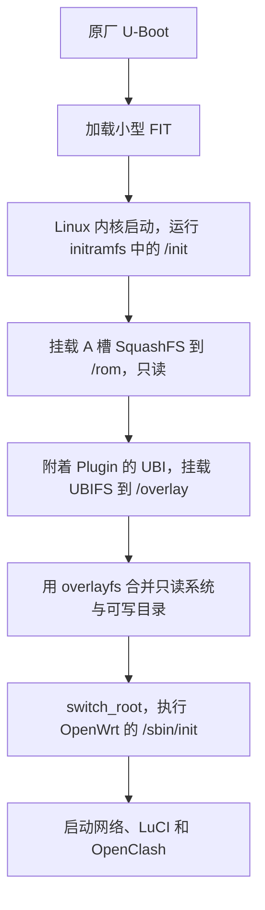

## 前言

手里有台中兴巡天 BE5100，想装 OpenWrt，顺便跑 OpenClash。这次我用 Codex 完成了适配，记录一下几个具体问题是怎么解决的。

我没有路由器适配经验，整个过程中只动手拆了设备、焊了串口调试线，除此之外就是提需求。固件逆向、驱动开发、镜像构建和软件调试全部通过 Codex 完成。

适配以 Linux、OpenWrt、mt76 和 cnjn 的 ZX279133/SR1010 项目等已有开源成果为基础，来源保留在仓库中。代码：[GaoYuCan/sr7100-openwrt](https://github.com/GaoYuCan/sr7100-openwrt)。

## 设备信息

| 项目 | 信息 |
| --- | --- |
| 产品名称 | 中兴巡天 BE5100 |
| 原厂系统标识 | SR7100 |
| SoC | ZX279133，双核 Cortex-A53，1 GHz |
| 内存 | 512 MiB DDR3 |
| 闪存 | 128 MiB SPI NAND，本机 ID 为 `ef-ae-21` |
| 无线芯片 | MediaTek MT7992，通过 PCIe 连接 |
| 网口 | WAN、LAN1、LAN2 |
| 原厂内核 | Linux 5.4.196，aarch64 |
| U-Boot | 2021.01 |
| 适配版本 | OpenWrt 25.12.5 / Linux 6.12.94 |

## 串口与调试环境

拆机后发现 PCB 上留有串口接口，家里刚好有排针，就焊了一组用于调试。

手边没有 USB 串口模块，但有一块 ESP32-C3-Supermini。我用 Codex 写了一个串口桥：电脑通过 USB 连接 ESP32，ESP32 再用 UART1 转发路由器串口的数据。GPIO4 是 TX，GPIO5 是 RX，和路由器的 RX、TX 交叉连接，另外共地。路由器串口测得约 3.3 V，两块板各自供电，不接 VCC。

串口用于在 Linux 启动前读取日志、进入 U-Boot 命令行。早期测试由原厂 U-Boot 通过 TFTP 把镜像下载到 RAM，再从 RAM 启动新内核，NAND 保留原系统，测试失败后重启即可返回。

TFTP 服务放在另一台有网口的 Linux 电脑上，网线接路由器。电脑自身通过手机热点接受远程管理，避免重启路由器时连调试主机也失联。串口桥代码和接线放在仓库的 [esp32-uart-bridge](../esp32-uart-bridge/README.md) 中。

## PCIe 与无线驱动适配

这部分主要是逆向还原原厂 PCIe 初始化流程，将它接入 Linux 的 PCIe 框架，并补充超时和中断状态处理。MT7992 的无线收发沿用 mt76，板级适配负责提供本机校准数据。

为了恢复初始化过程，我用 Codex 分析原厂 PCIe 驱动的设备初始化入口 `zx_pcie_probe` 和控制器设置函数 `zx133_pcie_controller_setup`，记录通用输入输出引脚（GPIO）的操作、延时和寄存器写入，再把对应的板级逻辑接到 Linux 的 DesignWare PCIe 框架上。通用框架负责 PCI 总线和资源管理，板级代码负责这颗 SoC 特有的初始化。

原厂 PCIe 驱动在初始化设备时，先把五条 GPIO 拉低，再按下面的顺序拉高：

```text
原厂 GPIO 编号：18 → 等待 3 ms → 37 → 等待 3 ms
               → 7 → 等待 18 ms → 8 → 等待 500 ms → 38
```

原厂 GPIO 编号使用自己的编码方式。我用 Codex 跟进设置引脚电平的函数 `zte_gpio_set_value`，确认它按 `bank = line >> 4`、`bit = line & 15` 选择 GPIO 控制器和位，再把它们转换成设备树里的控制器引用与引脚偏移。新驱动通过 Linux 的 GPIO 描述符接口（`gpiod`）执行同样的电平顺序。

PCIe 的物理层电路（PHY）负责建立芯片间的电气连接，这部分同样从原厂双通道初始化分支恢复寄存器写入序列。原厂有一处一直等待状态位的循环，新驱动改为带超时的轮询，硬件未就绪时返回错误。控制器初始化完成后，由 PCI 框架建立 CPU 访问无线芯片的地址映射，以及无线芯片直接读写 RAM 所需的 DMA 地址窗口。

中断使用原厂设备树中的传统引脚中断（INTx）映射，同时关闭原系统遗留的消息中断（MSI）接收状态，使中断配置与新驱动使用的方式一致。

控制器初始化完成后，内核扫描 PCI 总线，为 MT7992 加载 mt76 驱动。驱动还需要读取本机的射频校准数据，以使用这块板对应的射频参数。

构建设备树时，将本机 EEPROM 中的校准数据嵌入 `mediatek,eeprom-data` 属性，供驱动读取。mt76 原有加载失败后尝试默认数据的路径，我用 Codex 增加了板级检查：本机数据缺失或格式不匹配时返回错误，便于在启动日志中定位校准数据的加载问题。实现见 [EEPROM 补丁](../wireless/patches/100-f35sqa-require-board-calibration.patch)。

## 以太网与 DMA 适配

以太网适配建立在已有 ZX279133 驱动上。单口收发通过后，增加 WAN、LAN1、LAN2 的并行收发和接口归属处理。

这里涉及两层编号：SMAC 是对应物理网口的 MAC 单元，PPU 端口号则出现在内部转发和收发描述符中。结合 PHY 链路状态和真机收包采样，得到的映射是：

| 外壳端口 | SMAC | PHY 地址 | PPU 端口 |
| --- | --- | --- | --- |
| WAN | 0 | `0x0a` | 1 |
| LAN1 | 1 | `0x0b` | 2 |
| LAN2 | 2 | `0x0c` | 3 |

DMA 负责在硬件和 RAM 之间搬运数据包，描述符记录缓冲区地址、长度、来源等信息。这台设备的三个网口共用同一套 DMA 收发资源。Linux 虽然需要看到 `wan`、`lan1`、`lan2` 三个网络接口，底下却不能分别初始化三套独立的收发队列。

对照厂商实现和实际接收的描述符，来源端口位于描述符字段 `word1` 的第 16～21 位：

```c
unsigned int source = (word1 >> 16) & 0x3f;
```

取出的 `1..3` 对应表中的 PPU 端口，再减一得到 SMAC 下标。驱动据此选择接收接口，让后续的 Linux 网桥和防火墙知道包从哪里来。如果把 WAN 包误报为 LAN 包，上层根据接口划分的规则就失去了依据。因此来源不合法、对应接口未配置或已经关闭时，直接丢弃，不设置默认 LAN 接收口。实现见 [port-policy.h](../drivers/ethernet/port-policy.h)。

其次是接口的开关顺序。比如 WAN 和 LAN1 都开着，此时关闭 LAN1，不能顺便释放 WAN 仍在使用的 DMA 缓冲区；反过来，打开 LAN2 也不能重新初始化 DMA，把另外两个口正在处理的描述符覆盖掉。

驱动用一个位图 `datapath_users` 记录哪些接口处于打开状态，并用同一把锁保护状态切换。下面以两个口为例，第三个口遵循相同规则：


关闭接口时，已经提交的发送描述符可能仍引用该接口，驱动先暂停提交并等待发送完成，再释放接口。处理完待发送数据后，剩余端口继续收发；如果等待超时，就停止整个共享数据通路并记录故障，避免 DMA 继续访问已经失效的对象。具体代码在 [sr7100-shared-netdev.inc](../drivers/ethernet/sr7100-shared-netdev.inc)。

### 自动启动后的网口故障

测试时，进入 U-Boot 菜单后手工加载镜像，Linux 可以联网；让设备自己上电启动，网口却不通。

两次运行的驱动没有变化，差别在 Linux 接管之前。我用 Codex 对比原厂 U-Boot 的两个启动分支，发现自动启动在跳进内核前调用了一个给 PHY 掉电的函数，而菜单启动路径跳过了它。

以太网 PHY 负责网线上的电信号和链路协商。此时 CPU 和 Linux 正常运行，但 PHY 处于掉电状态，无法与网线另一端建立链路。

原厂函数对 PHY 地址 `0x0a..0x0d` 的控制寄存器执行了下面的操作。这里是等价伪代码：

```c
bmcr = mdio_read(phy_addr, 0);
mdio_write(phy_addr, 0, bmcr | 0x0800);
```

寄存器 0 是基本模式控制寄存器 BMCR，`0x0800` 对应 `BMCR_PDOWN`，置位表示掉电。实际故障状态下读到的值为 `0x1a40`，其中确实包含这一位：

```text
0x1a40 & 0x0800 = 0x0800
```

之前的驱动沿用了“PHY 已经工作”的状态假设，菜单测试正好满足这个条件，自动启动则不满足。修改是在 PHY 驱动的初始化和恢复回调中调用 `genphy_resume`：

```c
.config_init = genphy_resume,
.resume      = genphy_resume,
```

`genphy_resume` 清除 BMCR 的掉电位，恢复 PHY 工作，同时保留原厂设置的调校参数。修改后先在 RAM 测试中重现掉电状态、确认驱动能恢复，再验证安装后的自主启动和断电重上电。完整驱动见 [sr7100-gephy.c](../drivers/ethernet/sr7100-gephy.c)。

## 启动镜像与 rootfs

RAM 测试时，为了不依赖 NAND 上的原系统，测试镜像把内核和完整用户空间一起带上了。内核负责驱动硬件，用户空间则包含 OpenWrt 的命令、管理页面、网络服务，以及 OpenClash、Mihomo 等程序。加起来，早期启动包约 42 MiB。

FIT 是 U-Boot 读取的打包格式，可以同时描述内核、设备树和启动用的内存文件系统。RAM 测试将整个系统打成一个 FIT，通过 TFTP 一次加载。把同样的大包写入 NAND 后，原厂自动启动流程出现了内存分配失败。

原厂 U-Boot 的动态分配器使用一块固定大小的内存。逆向堆初始化函数可以看到长度参数 `0x840000`，换算为 8.25 MiB；运行时读取堆的起止地址也能对上这个大小。自动启动处理载荷时使用这套分配器，可分配空间受这块堆限制，而不是整机的 512 MiB RAM。

为了保留原厂 U-Boot 作为恢复入口，我用 Codex 调整镜像组织方式，将根文件系统（rootfs）分离：U-Boot 只加载启动 Linux 必需的内容，完整系统等 Linux 启动后再从 NAND 挂载。

具体拆成三部分：

| 部分 | 存放内容 | 何时使用 |
| --- | --- | --- |
| 小型 FIT | 内核、设备树、小型 initramfs | 由 U-Boot 加载，启动 Linux |
| A 槽 SquashFS | 完整 OpenWrt、LuCI、OpenClash 等程序 | Linux 启动后挂载为只读系统 |
| Plugin 上的 UBIFS | 配置和后续修改的文件 | 与只读系统合并，提供可写根目录 |

initramfs 是内核刚启动时使用的内存文件系统，此处包含 BusyBox、必要依赖、UBI 附着工具和 `/init` 脚本，用于挂载 NAND 上的正式系统并切换根目录。



UBI 负责 NAND 的擦除块管理，UBIFS 是运行在它上面的文件系统；overlayfs 则负责把两个目录合成一个视图。读取未修改的系统文件时，内容来自 SquashFS；修改配置时，新内容写入 Plugin 的可写层，重启后继续使用。

启动脚本里的核心操作如下，省略了挂载点准备和错误处理：

```sh
mount -t squashfs -o ro /dev/mtdblock1 /rom
/bin/sr7100-plugin-ubi attach
mount -t ubifs ubi0:rootfs_data /overlay
mount -t overlay overlay \
    -o lowerdir=/rom,upperdir=/overlay/upper,workdir=/overlay/work /newroot
# 随后将 /dev、/proc、/sys 等挂载移动到新根目录
exec switch_root /newroot /sbin/init
```

这里的分区编号是适配后设备树的编号，不是原厂的 `/proc/mtd` 编号。实际 [init-installed](../userspace/init-installed) 会先校验分区名和布局标记；挂载失败就停在诊断 shell，不会自动格式化 Plugin 把配置清掉。

拆分后，U-Boot 加载的 FIT 约 5.4 MiB，Linux 挂载的 SquashFS 约 33.2 MiB。

## NAND 分区与恢复验证

保留 U-Boot 可执行代码，是为了在内核或 rootfs 刷坏后，仍能进入命令行，通过 TFTP 加载恢复镜像并写回系统。U-Boot 损坏则会失去这条恢复路径。

### 原厂分区

原厂 NAND 共 128 MiB，互不重叠的物理范围如下。地址均为数据区偏移，终点不包含在区间内：

| 起点 | 终点 | 大小 | 原厂用途 |
| --- | --- | --- | --- |
| `0x0000000` | `0x0100000` | 1 MiB | 早期 bootloader、环境等 |
| `0x0100000` | `0x0200000` | 1 MiB | tags |
| `0x0200000` | `0x0400000` | 2 MiB | Wi-Fi 数据 |
| `0x0400000` | `0x0600000` | 2 MiB | usercfg |
| `0x0600000` | `0x0800000` | 2 MiB | defcfg |
| `0x0800000` | `0x3500000` | 45 MiB | A 系统槽 |
| `0x3500000` | `0x6200000` | 45 MiB | B 系统槽 |
| `0x6200000` | `0x8000000` | 30 MiB | Plugin |

A/B 各是一块系统存储范围，包含槽内 U-Boot、内核载荷、rootfs 和版本信息。原厂的 `kernel1`、`kernel2` 分别覆盖整个槽位，`rootfs1` 等指向槽内的一部分数据，`whole flash` 覆盖整片 NAND。这些视图存在重叠。

两份槽内 U-Boot 分别位于 A 开头的 `0x0800000..0x0980000` 和 B 开头的 `0x3500000..0x3680000`，各占 1.5 MiB。前面的 1 MiB bootloader 分区存放更早的引导程序，开机先执行它，再定位并加载槽内 U-Boot。刷写保护范围包含这三处引导代码。

### 备份和写回测试

备份时先从 U-Boot 启动 RAM 系统，不挂载可写的 NAND 文件系统，避免备份过程中配置还在变化。对完整 128 MiB 连续读取两次，哈希一致后，在 Mac 和独立 Linux 主机各保存一份。

备份读取经过错误校正（ECC）处理的数据区。NAND 每页还有保存校验等信息的附加区（OOB），本次备份不包含这部分，恢复时同样使用数据区读写方式，由控制器处理校验信息。

我用 Codex 把备份分成 16 个 8 MiB 块，通过 TFTP 下载到 RAM，再用 U-Boot 从 NAND 读取对应范围到另一块缓冲区，逐字节比较两份数据。

写回验证安排在后续准备扩容的 B 系统载荷和 Plugin 范围内，保留 A 系统和两份 U-Boot：

1. 通过 U-Boot 写入候选布局和新的 UBI 数据，逐块读回比较。
2. 启动 RAM 测试系统，只开放候选 Plugin 范围的写权限。
3. 挂载 UBIFS，写入 8 MiB 随机文件，记录哈希；卸载、重新挂载后再次读取校验。
4. 回到 U-Boot，用备份恢复 B 系统载荷和原 Plugin，逐字节比较恢复结果。
5. 再次检查保护范围，确认 A 系统和引导代码没有变化。

写回和恢复测试通过后，再进行正式扩容。

### 刷写范围控制

实际写入使用 U-Boot 的 `mtd erase`、`mtd write`。脚本先把物理偏移换成对应分区内的偏移，检查起点和长度均按 `0x20000`，即 128 KiB 擦除块对齐，再检查整个范围落在当前操作允许修改的区域内。

每块数据的流程是 TFTP 下载、CRC 检查、擦除、写入、读回比较；跨原厂 A/B/Plugin 边界时拆成不同操作。最终提交 A 的版本头之前，先完成内核和 rootfs 的写入与校验，避免先把尚未写完的系统登记为候选版本。

脚本还核对设备分区表、当前坏块状态以及保护区内容。本机测试时没有坏块，新坏块处理尚未验证。

两份 U-Boot 的可执行字节在修改前后保持一致。自动启动适配修改了环境中的 `bootcmd`、`versioninfo`、`initrd_high`。

## Plugin 分区扩容

安装 OpenWrt 后，A 槽存放启动包和只读 rootfs，Plugin 存放可写配置和更新后的 Mihomo 核心。原来的 Plugin 只有 30 MiB，而 B 槽仍占用 45 MiB。我提出取消 B 系统，将空间合并给 Plugin，但继续保留 B U-Boot 作为恢复入口。

按上面的原厂分区，B 槽开头的 1.5 MiB 是 U-Boot，后面还有 43.5 MiB。把这 43.5 MiB 与原 Plugin 的 30 MiB 连起来，理论上可以得到 73.5 MiB，也就是从 `0x3680000` 一直延伸到 NAND 末尾。

分析早期引导程序后，确认了 B U-Boot 的定位过程：先扫描有效版本头，再找内核定位标记，随后从标记向前回退 12 个有效擦除块。本机没有坏块时，这个距离是 `12 × 128 KiB = 1.5 MiB`。

因此，B U-Boot 的代码虽然在回收范围外，但版本头和定位标记在范围内。如果把后两者一并交给 UBIFS，以后它们被覆盖，早期引导程序就可能找不到尚且完好的 B U-Boot。

最终额外保留两个擦除块，共 256 KiB：第一个放 B 定位标记，第二个放 B 救援版本头。前后对比如下：

| 物理范围 | 大小 | 原厂布局 | 扩容后布局 |
| --- | --- | --- | --- |
| `0x3500000..0x3680000` | 1.5 MiB | B U-Boot | 保留 |
| `0x3680000..0x36c0000` | 0.25 MiB | B 系统载荷的一部分 | 救援定位标记和版本头 |
| `0x36c0000..0x6200000` | 43.25 MiB | B 系统其余载荷及元数据 | 并入 Plugin |
| `0x6200000..0x8000000` | 30 MiB | 原 Plugin | 与上一段组成新 Plugin |

新 Plugin 最终为 `43.25 + 30 = 73.25 MiB`。这表示原始分区容量；UBI/UBIFS 还需要元数据和保留空间，文件系统显示的可用总量会小于这个数字。

Linux 设备树同步改为新的 Plugin 起点和长度，NAND 驱动也只允许这段范围的编程和擦除；A 系统、两份 U-Boot 和 B 救援信息保持只读。

启动日志确认早期引导程序能识别新的 B 救援头。A 头或定位标记损坏后的回退分支，通过执行原始早期引导代码进行仿真验证，未做真机破坏测试。扩容后 B 槽保留引导和救援信息，恢复时通过串口进入 U-Boot，再用 TFTP 加载或写回系统。

## Mihomo 核心持久化

OpenClash 的小闪存模式把可执行核心放在使用 RAM 的 `/tmp` 目录，重启后内容消失。因此更新脚本还需要将新核心保存到 Plugin，并在下次启动时恢复。

我用 Codex 增加了保存与恢复脚本，把三个位置的作用分开：

| 位置 | 作用 |
| --- | --- |
| Plugin 的 `/overlay/sr7100-core/` | 保存当前核心的压缩归档和版本指针 |
| RAM 的 `/tmp/etc/openclash/core/` | 保存本次启动实际执行的核心 |
| 只读 rootfs | 保存随镜像打包的回退核心 |

更新不能直接删旧核心再写新核心，否则下载失败、空间不足或者写入中断都可能导致两份都不可用。[core-store](../userspace/core-store) 按下面的顺序提交：

1. 运行新核心的版本检查和配置检查，确认它能执行，并能接受当前 OpenClash 配置。
2. 在 RAM 中压缩新核心，计算哈希，检查 Plugin 是否有空间同时容纳旧归档和新归档。
3. 将新归档写到 Plugin 临时文件，同步并校验后改成正式文件名；文件名使用核心内容的 SHA-256。
4. 写入新的 `current` 临时文件，再重命名替换旧指针。这个指针决定下次启动恢复哪个归档。
5. 只有确认当前指针所指的归档完整之后，才清理旧归档和更新残留。

重启时先读取 `current`，校验对应压缩包，再解压到 RAM。如果指针、归档或解压后的核心无效，就从只读 rootfs 补入原始核心。日常核心更新不会改写这份回退文件。

初版在 Plugin 留了当前和上一版两个核心，约占 40 MiB。考虑到 rootfs 已有回退版本，我又要求 Plugin 在更新完成后只保留当前核心。提交过程中保留新旧两份，空间不足时拒绝更新。

离线测试在八个提交边界强制结束进程，检查旧版本或已提交的新版本能否恢复；实机通过 OpenClash 更新脚本切换 v1.19.31 → v1.19.32，再普通重启确认运行版本和单份归档。最终 `df` 显示剩余闪存空间约 37.2 MiB。

MetaCubeXD 的网页文件更新后写入可写层，重启后保留。升级整个 OpenClash 插件时，需要重新核对更新和启动脚本中的持久化调用，防止被新版脚本覆盖。

## 测试结果

目前设备可以正常上电进入 OpenWrt，不需要串口辅助启动。三口收发、WAN/LAN 隔离、NAT、双频无线、配置保留、OpenClash 和核心更新已做过实机验证。扩容后的系统做过真正断电重上电，后续单核心策略调整又做了普通重启验证。

长期稳定性、极限吞吐、完整 IPv6、MSI、核心更新过程中的 NAND 断电测试和通用升级流程尚未完成验证。构建方法与验证范围分别在 [BUILD.md](BUILD.md) 和 [VALIDATION.md](VALIDATION.md)，本机校准数据、原厂微码和设备备份不随仓库发布。
